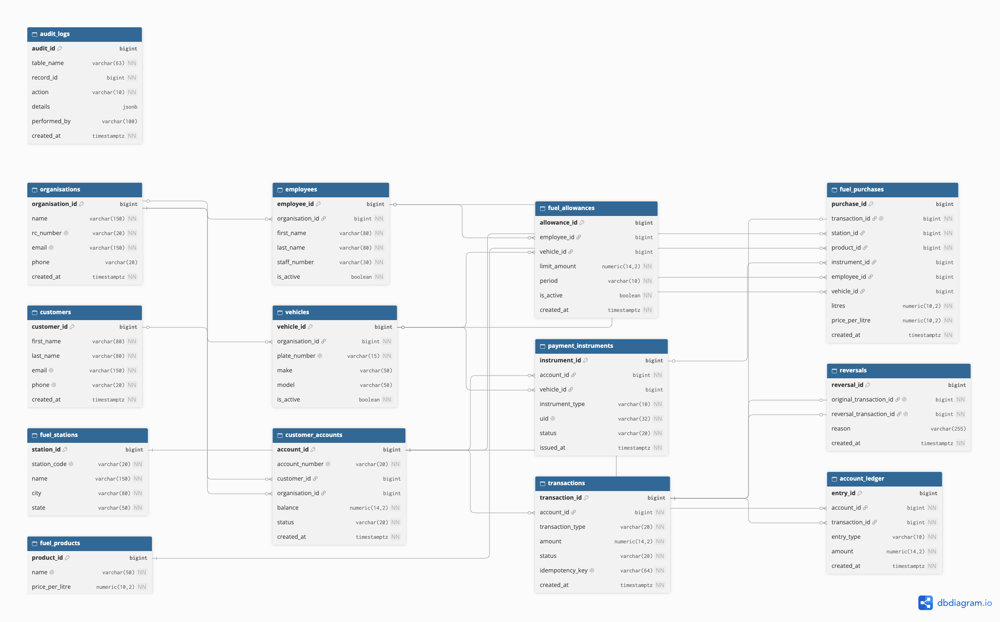

# Portfolio 1 – Database Design and Modelling

Business rules and design decisions are in [../docs/business-requirements.md](../docs/business-requirements.md).

## Entities

Each table exists because at least one business rule needs it.

| Entity | What it stores | Needed for |
|---|---|---|
| organisations | Companies using FuelPay for their fleet | BR-002, BR-003 |
| customers | Individual customers | BR-001, BR-003 |
| employees | Staff belonging to an organisation | BR-002, BR-006 |
| vehicles | Vehicles registered by an organisation | BR-002, BR-006 |
| customer_accounts | Accounts that hold a balance and pay for fuel | BR-003, BR-008 |
| payment_instruments | NFC cards and tags linked to accounts | BR-004 |
| fuel_stations | Filling stations on the network | BR-007, BR-015 |
| fuel_products | Fuel types (petrol, diesel, etc.) and prices | BR-007, BR-015 |
| fuel_allowances | Spending limits for employees or vehicles | BR-006 |
| fuel_purchases | What was bought: station, product, litres | BR-007, BR-015 |
| transactions | Money movements: amount, status, idempotency reference | BR-005, BR-009, BR-010 |
| account_ledger | Debit and credit entries behind every balance change | BR-008, BR-012 |
| reversals | Links a reversed transaction to its reversal | BR-011 |
| audit_logs | Record of important actions | BR-012 |

**Purchases vs transactions:** a purchase records what happened at the pump; a transaction records the money. Funding an account creates a transaction without a purchase, so they're kept separate.

Left out on purpose:
- **station_inventory**: no requirement needs fuel stock levels. Fuel use reports come from purchases.
- **settlements**: paying stations is a separate process that none of the requirements cover.

## Relational schema

All primary keys are auto-generated IDs. Money is `NUMERIC(14,2)` (exact, no rounding errors). Times are `TIMESTAMPTZ`.

- **organisations**: `organisation_id` PK, `name`, `rc_number` UNIQUE, `email` UNIQUE, `phone`, `created_at`
- **customers**: `customer_id` PK, `first_name`, `last_name`, `email` UNIQUE, `phone` UNIQUE, `created_at`
- **employees**: `employee_id` PK, `organisation_id` FK, `first_name`, `last_name`, `staff_number`, `is_active`. UNIQUE (`organisation_id`, `staff_number`)
- **vehicles**: `vehicle_id` PK, `organisation_id` FK, `plate_number` UNIQUE, `make`, `model`, `is_active`
- **customer_accounts**: `account_id` PK, `account_number` UNIQUE, `customer_id` FK (nullable), `organisation_id` FK (nullable), `balance` CHECK (>= 0), `status` (active / suspended / closed), `created_at`
- **payment_instruments**: `instrument_id` PK, `account_id` FK, `vehicle_id` FK (nullable, tags only), `instrument_type` (card / tag), `uid` UNIQUE, `status` (active / blocked / expired), `issued_at`
- **fuel_stations**: `station_id` PK, `station_code` UNIQUE, `name`, `city`, `state`
- **fuel_products**: `product_id` PK, `name` UNIQUE, `price_per_litre` CHECK (> 0)
- **fuel_allowances**: `allowance_id` PK, `employee_id` FK (nullable), `vehicle_id` FK (nullable), `limit_amount` CHECK (> 0), `period` (daily / weekly / monthly, default monthly), `is_active`, `created_at`
- **transactions**: `transaction_id` PK, `account_id` FK, `transaction_type` (funding / purchase / reversal), `amount` CHECK (> 0), `status` (pending / successful / failed / reversed), `idempotency_key` UNIQUE, `created_at`
- **fuel_purchases**: `purchase_id` PK, `transaction_id` FK UNIQUE, `station_id` FK, `product_id` FK, `instrument_id` FK (nullable, app payments have none), `employee_id` FK (nullable), `vehicle_id` FK (nullable), `litres` CHECK (> 0), `price_per_litre`, `created_at`
- **account_ledger**: `entry_id` PK, `account_id` FK, `transaction_id` FK, `entry_type` (debit / credit), `amount` CHECK (> 0), `created_at`
- **reversals**: `reversal_id` PK, `original_transaction_id` FK UNIQUE, `reversal_transaction_id` FK UNIQUE, `reason`, `created_at`
- **audit_logs**: `audit_id` PK, `table_name`, `record_id`, `action` (insert / update / delete), `details` JSONB, `performed_by`, `created_at`

### Rules across columns

- An account has exactly one owner: a customer or an organisation.
- An allowance targets exactly one of an employee or a vehicle.
- Only tags can be linked to a vehicle; cards can't.
- A transaction can be reversed only once (UNIQUE on `original_transaction_id`).

### Why some columns are (or aren't) there

- **Price is stored on each purchase** because product prices change. The purchase must keep the price actually paid.
- **fuel_purchases has no account_id**; the account comes through its transaction. Storing it twice would let the two disagree.
- **fuel_allowances has no organisation_id**; the organisation comes through the employee or vehicle, for the same reason.

## ER diagram



Drawn in dbdiagram.io using crow's foot notation. A circle means optional (zero), a bar means mandatory (one), and the crow's foot means many. audit_logs has no relationships because it records actions on any table using table_name and record_id.

## Normalisation

To show how the tables were arrived at, start with a single unnormalised fuel receipt:

| receipt_no | customer | account_no | station | station_city | product | price | litres | cards |
|---|---|---|---|---|---|---|---|---|
| R001 | Ada Obi | ACC-001 | Wuse Station | Abuja | Petrol | 1000.00 | 20 | CARD-11, TAG-27 |

**1NF – one value per cell.** The `cards` column holds a list, so cards and tags move to their own table with one row each (**payment_instruments**). The customer name is also split into first and last name.

**2NF – no partial dependencies.** Every table uses a single-column surrogate key, so no column can depend on only part of a key. The one composite rule, UNIQUE (organisation_id, staff_number) on employees, is a uniqueness rule, not the primary key.

**3NF – no transitive dependencies.** In the receipt, `station_city` depends on the station, not the receipt, and the customer depends on the account, not the receipt. Each of these becomes its own table (**fuel_stations**, **fuel_products**, **customers**, **customer_accounts**) and the purchase keeps only the foreign keys. For the same reason:
- **fuel_purchases** has no `account_id`. The account is reached through the transaction.
- **fuel_allowances** has no `organisation_id`. The organisation is reached through the employee or vehicle.

### Deliberate exceptions

- **balance** on customer_accounts could be calculated from the ledger. It's kept so balance checks are fast and so concurrent payments have a single row to lock (Portfolio 3). It's only ever changed in the same database transaction as a ledger entry, so the two can't drift apart.
- **price_per_litre** on fuel_purchases is not a duplicate of the product price. It records the price at the time of sale, which stays the same when the product price changes.
- **amount** on transactions matches litres × price for purchases, but fundings and reversals have no litres, so the amount is stored on the transaction itself.

## Implementation

PostgreSQL 17 runs in Docker (see `docker-compose.yml` in the repo root). Port 5433 is used on the host because a local PostgreSQL install already uses 5432.

| Script | What it does |
|---|---|
| [sql/01_create_tables.sql](sql/01_create_tables.sql) | Creates the 14 tables with primary keys and data types |
| [sql/02_constraints.sql](sql/02_constraints.sql) | Adds 19 foreign keys, 14 UNIQUE and 19 CHECK constraints, each named after the rule it enforces |
| [sql/03_seed_data.sql](sql/03_seed_data.sql) | Loads synthetic data: 205 accounts, 10,000 purchase attempts over 6 months, about 3% failed, 20 reversals |
| [sql/04_validation_tests.sql](sql/04_validation_tests.sql) | Tries to break each business rule and checks which constraint stops it |

To run:

```bash
docker compose up -d
for f in portfolio-1-database-design/sql/0*.sql; do
  docker exec -i fuelpay-postgres psql -U fuelpay -d fuelpay -v ON_ERROR_STOP=1 < "$f"
done
```

The seed balances are not typed in. Every funding, purchase and reversal writes a ledger entry, and each balance is then calculated from the ledger.

## Testing

[evidence/validation-results.txt](evidence/validation-results.txt) shows the test output. Each of the 15 tests tries to insert or change data that breaks a rule (duplicate email, card linked to a vehicle, negative balance, duplicate idempotency key, reversing a transaction twice, and so on). A test passes only if the database rejects it with the expected constraint. The tests run inside a transaction that is rolled back, so they leave no data behind.

The same file also checks the seeded data: every balance matches its ledger, every successful purchase has a pump record, and every reversed purchase has a reversal record.
